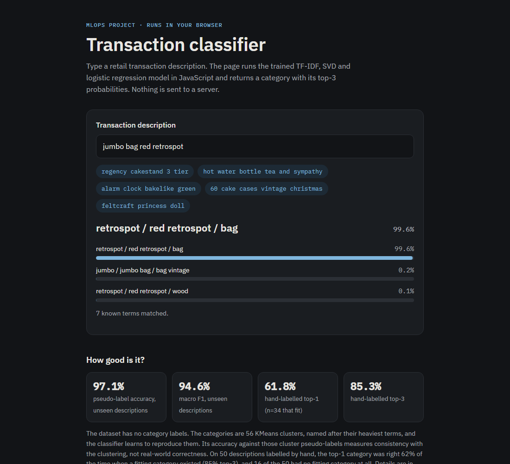
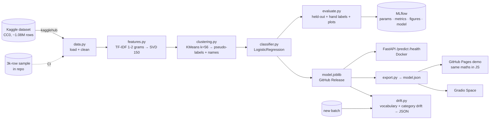
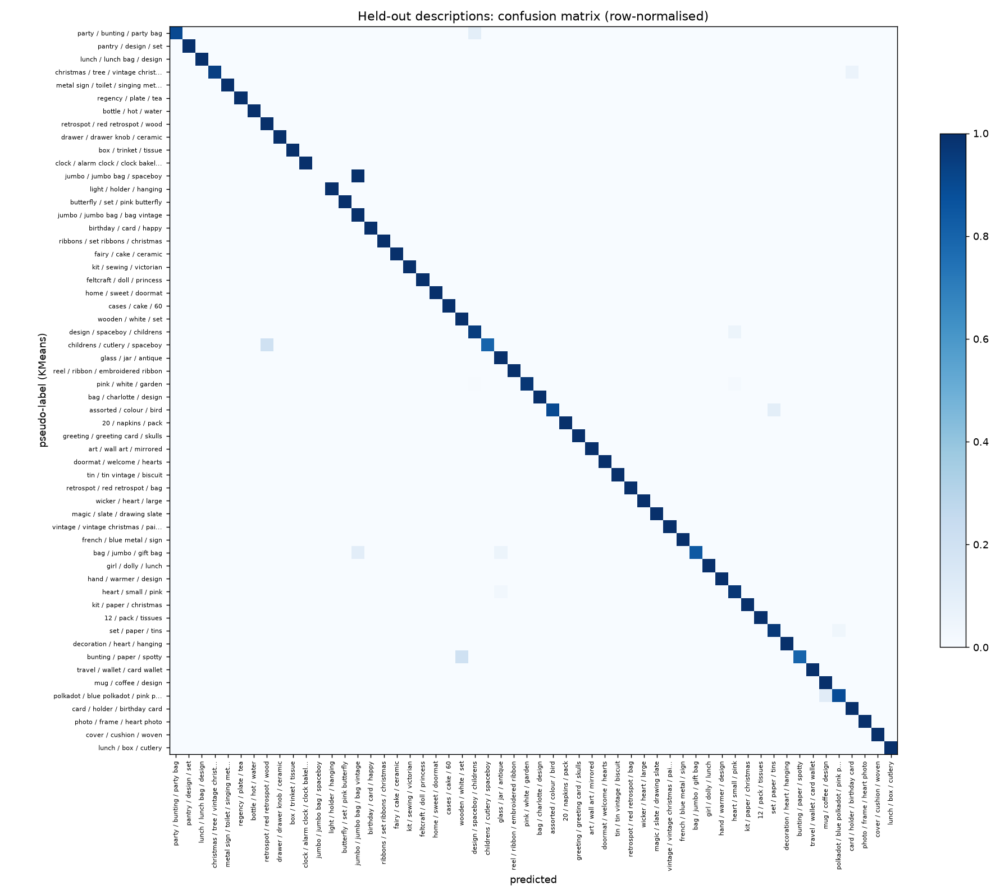
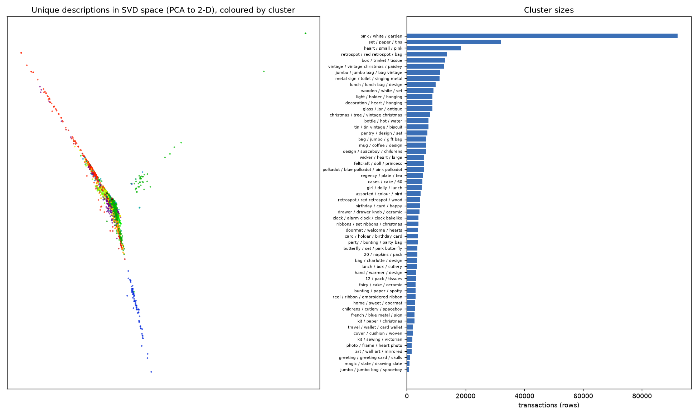

# Transaction classifier: an MLOps project

Predicts the product category of a retail transaction from its free-text description. The pipeline is TF-IDF, then TruncatedSVD, then KMeans pseudo-labels, then logistic regression. It is packaged as a reproducible pipeline with MLflow tracking, a CLI, a FastAPI service, a Docker image, CI, a drift check and a demo that runs the model in your browser.

**[▶ Live demo](https://nardy11.github.io/transaction-classifier-mlops/)**: type a description and get the category and its top-3 probabilities. The model runs in JavaScript, with no server.

[](https://github.com/Nardy11/transaction-classifier-mlops/actions/workflows/ci.yml)
[](LICENSE)


[](https://nardy11.github.io/transaction-classifier-mlops/)

## What it does

Bank and expense apps show spending by category, but raw transaction data rarely comes with one. This project starts from roughly one million unlabelled retail transactions and does the following:

1. **Cleans** the descriptions and the numeric columns: duplicates, nulls, symbols and IQR outliers.
2. **Discovers categories** by clustering the TF-IDF/SVD vectors of the descriptions into 56 groups. Each group is named automatically after its heaviest terms, for example `bottle / hot / water`.
3. **Trains a classifier** to predict those groups for new, unseen descriptions.
4. **Serves** the classifier as a batch REST API, a Docker image, a static web page and a Gradio Space.
5. **Watches inputs** with a drift report that compares a new batch with the training data.

The original research notebook from the ReDI School course is kept in [`notebooks/`](notebooks/Transaction_Category_Prediction_ML.ipynb). This repository turns it into a pipeline that can be run, tested and deployed.

## Architecture



Configuration is in YAML: [`configs/default.yaml`](configs/default.yaml) for the full run and [`configs/ci.yaml`](configs/ci.yaml) for the smoke run. Each `train` run logs its config, metrics, figures, the joblib artifact and an MLflow sklearn model to a local `mlruns/` store (SQLite, git-ignored).

## Results

All numbers come from `python -m txclf train --config configs/default.yaml` on the full Kaggle file. They are also in [`reports/metrics.json`](reports/metrics.json).

| | |
|---|---|
| Raw rows | 1,083,818 |
| Rows after cleaning (dedupe, nulls, IQR outliers) | 421,093 |
| Distinct descriptions after cleaning | **3,757** |
| TF-IDF vocabulary / SVD components (explained variance) | 5,000 / 150 (33.8%) |
| KMeans clusters / silhouette | 56 / 0.106 |
| Largest cluster | 21.9% of rows (`pink / white / garden`, a catch-all) |

**Classifier against the KMeans pseudo-labels.** These descriptions were split 80/20, so every test description is unseen:

| Split | Accuracy | Macro F1 | Row-weighted accuracy |
|---|---|---|---|
| Descriptions seen in training | 99.3% | 99.1% | 99.8% |
| **Held-out descriptions** | **97.1%** | **94.6%** | **95.9%** |
| Held-out, classifier trained on shuffled labels (baseline) | 2.1% | | |

**What these numbers mean.** The roughly one million rows are repeat purchases of only 3,757 distinct product descriptions. A row-level train/test split, which the notebook used and which reported about 99%, puts the same description in both train and test. This repo therefore splits by description. More importantly, the labels are KMeans clusters built from the same TF-IDF/SVD features the classifier uses. High accuracy here means *the classifier reproduces the clustering consistently*, not that the categories are correct.

**Hand-labelled check (n = 50).** To get a small real check, 50 descriptions were drawn at random, weighted by row frequency, and each was given the cluster name that fits best by reading the text alone. The model's predictions were not shown during labelling. The labelling was done during this refactor by the AI assistant that built the pipeline: one labeller, with no second review. Treat it as indicative. The file is [`data/hand_labels.csv`](data/hand_labels.csv).

| | |
|---|---|
| Descriptions where none of the 56 categories fits (for example "pick up sticks game", "bottle opener") | 16 / 50 |
| Top-1 correct, all 50 | 42% |
| **Top-1 correct, where a category fits (n = 34)** | **62%** |
| **Top-3 contains the right category (n = 34)** | **85%** |

Most top-1 misses fall between near-duplicate clusters: two Christmas clusters, two "tins" clusters, two "card" clusters and two "retrospot" clusters. Some fall into the catch-all `pink / white / garden`. The weak link is the clustering, not the classifier. That points to the next improvements: fewer or merged clusters, better text embeddings, and a properly labelled evaluation set.

<p>


</p>

The browser demo runs the same full model, not a reduced copy. TF-IDF, SVD and logistic regression are linear up to the softmax, so the SVD and the classifier weights fold into one 56 × 5,000 matrix, which is stored as int16. The result is an 860 KB JSON file (460 KB gzipped). A test checks that JavaScript and Python agree on 24 inputs: same top-1, and probabilities within 0.002.

## Model card

| | |
|---|---|
| **Model** | TF-IDF (1-2 grams, English stop words, 5,000 terms) → TruncatedSVD (150) → multinomial logistic regression (balanced class weights) over 56 KMeans clusters |
| **Input** | One free-text item description, for example `WHITE HANGING HEART T-LIGHT HOLDER` |
| **Output** | Category name, probability, top-k list, and `known_terms` (vocabulary terms matched; 0 means the output is only the prior) |
| **Training data** | [Transaction Data](https://www.kaggle.com/datasets/vipin20/transaction-data) by vipin20 on Kaggle, licence **CC0 Public Domain**. About 1.08M rows from one UK online gift retailer, roughly 90% UK customers. Only `ItemDescription` is used by the model. The full dataset is not committed; [`data/sample/`](data/sample) holds a 3,000-row random sample for CI. |
| **Labels** | No ground truth. Categories are KMeans clusters, named automatically from their top terms. |
| **Evaluation** | Consistency with the pseudo-labels on held-out descriptions (97.1% accuracy), plus a small hand-labelled check (62% top-1 / 85% top-3 where a category fits). See [Results](#results). |
| **Intended use** | Demonstrating an end-to-end MLOps workflow; grouping descriptions from a similar product catalogue. |
| **Not suitable for** | Categorising bank or card transactions in general (merchant names, groceries, travel). Those words are mostly out of vocabulary, and the drift check flags them. Not for any decision about a person. |
| **Known limitations** | One retailer and one language. Several near-duplicate clusters plus one large catch-all. Cluster names are term lists, not curated labels. Retraining with a different config or seed changes the label set. |
| **Differences from the notebook** | The model uses the description only. The notebook also fed scaled quantity and price columns, but text carried the signal (about 28% accuracy without it). Models are fitted on distinct descriptions weighted by their row counts, not on repeated rows. Rows with an empty description are dropped instead of forming a "nan" cluster. Cluster names are generated, not hand-typed. |
| **Ethics** | The data is heavily skewed to UK customers. Nothing in the data identifies a person beyond an opaque `UserId`, which the model does not use. |

## Monitoring: drift check

```bash
python -m txclf drift new_batch.csv --column ItemDescription --out drift.json [--fail-on-drift]
```

The training reference is stored inside the model artifact. The report compares the batch with that reference:

- **Vocabulary**: the share of tokens the model has never seen (the out-of-vocabulary rate), compared with training; the share of rows with no known term; the Jensen-Shannon distance between term distributions; and the most frequent unseen tokens.
- **Predictions**: the Population Stability Index and the JS distance between the predicted category distribution of the batch and of the training data, plus the 10 largest category shifts.

Default thresholds: an OOV increase above 0.10, empty rows above 5%, term JS above 0.30, or category PSI above 0.20. Any one of these sets `drift_detected: true`. With `--fail-on-drift`, the command exits 1, so it can gate a scheduled job. Two examples:

- [`reports/drift_sample.json`](reports/drift_sample.json): the 3,000-row in-distribution sample. No drift: OOV 3.3% against 2.9% at training, PSI 0.03.
- [`reports/drift_foreign.json`](reports/drift_foreign.json): card-statement lines such as `UBER TRIP` and `NETFLIX.COM`. All four checks fire: OOV 63%, 25% of rows have no known term, PSI 4.8.

## Quickstart

```bash
python -m venv .venv && source .venv/bin/activate      # Windows: .venv\Scripts\activate
pip install -r requirements.txt -e ".[dev]"

# train on the full dataset (kagglehub downloads it; no Kaggle login needed for this public dataset)
python -m txclf train                                  # ~1-2 min on a laptop
mlflow ui --backend-store-uri sqlite:///mlruns/mlflow.db   # browse runs at http://127.0.0.1:5000

# or skip training: download the released model
curl -L -o models/model.joblib --create-dirs \
  https://github.com/Nardy11/transaction-classifier-mlops/releases/download/v1.0.0/model.joblib

python -m txclf predict "jumbo bag red retrospot" "regency cakestand 3 tier"
python -m txclf evaluate --hand-labels data/hand_labels.csv
python -m txclf export-web                             # rebuild docs/model.json for the demo
```

**Serve:**

```bash
uvicorn txclf.api:app --port 8000          # TXCLF_MODEL=models/model.joblib by default
curl -X POST localhost:8000/predict -H "content-type: application/json" \
  -d '{"descriptions": ["jumbo bag red retrospot", "alarm clock bakelike green"], "top_k": 3}'
curl localhost:8000/health
```

**Docker** (the image downloads the v1.0.0 model at build time; pass `--build-arg MODEL_URL=...` to serve your own):

```bash
docker build -t txclf .
docker run -p 8000:8000 txclf
```

> `model.joblib` is a pickle. Only load artifacts you trust. The web demo and the Space use the plain-JSON export instead.

**Hugging Face Space.** [`space/`](space) is a ready Gradio app with the Space frontmatter. It uses the same `model.json` as the web demo and needs only numpy. To deploy it:

1. Create a free account at huggingface.co, then **New Space** → SDK **Gradio** → name it `transaction-classifier`.
2. Copy the contents of `space/` into the Space repository, and copy `docs/model.json` next to `app.py`. If you skip that, the app fetches the file from GitHub Pages at start-up.
3. `git add . && git commit -m "Deploy" && git push`. The Space builds and goes live at `https://huggingface.co/spaces/<user>/transaction-classifier`.

## Tests and CI

`pytest` runs 22 tests. They cover text and row cleaning, the full pipeline on the 3,000-row sample (metrics, predict, save and load, drift), the API (health, batch predict, validation, missing model returns 503), and JavaScript/Python parity on the CI model and on the released model when it is present. On every push, [GitHub Actions](.github/workflows/ci.yml) runs `ruff check`, `ruff format --check` and the tests. It then smoke-trains on the sample with MLflow, runs `predict`, `drift` and `export-web`, and uploads the reports as a build artifact.

## Project structure

```
├── configs/               default.yaml (full run), ci.yaml (smoke run)
├── src/txclf/
│   ├── data.py            load (CSV or kagglehub) + cleaning
│   ├── features.py        TF-IDF → SVD pipeline
│   ├── clustering.py      KMeans pseudo-labels + automatic names
│   ├── classifier.py      logistic regression
│   ├── evaluate.py        metrics, hand-label check, figures
│   ├── train.py           orchestration + MLflow logging
│   ├── model.py           TxModel artifact + predict()
│   ├── drift.py           drift report
│   ├── export.py          model.json for the browser / Space
│   ├── api.py             FastAPI app
│   └── cli.py             python -m txclf train|evaluate|predict|export-web|drift
├── tests/                 pytest suite (incl. JS parity)
├── docs/                  GitHub Pages demo: index.html, txclf.js, model.json
├── space/                 Hugging Face Gradio Space
├── data/                  sample/ (3k CC0 rows), hand_labels.csv
├── reports/               metrics.json, categories.json, drift examples, figures/
├── notebooks/             original research notebook (Colab) + .py export
├── scripts/               web_predict.mjs (Node runner for the parity test)
├── Dockerfile
└── .github/workflows/ci.yml
```

The notebook [`notebooks/Transaction_Category_Prediction_ML.ipynb`](notebooks/Transaction_Category_Prediction_ML.ipynb) is the original exploration: EDA, the silhouette and elbow search that picked k = 56, hand-named clusters, and the numeric-feature ablation. The final course presentation (PPTX) is attached to the [v1.0.0 release](https://github.com/Nardy11/transaction-classifier-mlops/releases/tag/v1.0.0).

## Credits

- Built by **Nardy Attaalla** as the final project of the [ReDI School](https://www.redi-school.org/) Machine Learning course, then rebuilt as an MLOps pipeline.
- Dataset: [Transaction Data](https://www.kaggle.com/datasets/vipin20/transaction-data) by Vipin Kumar (vipin20) on Kaggle, CC0 Public Domain.
- Built with scikit-learn, MLflow, FastAPI and Gradio. ChatGPT was used for brainstorming and debugging in the original notebook, as the course's academic-honesty rules required. Claude helped build the MLOps refactor.

## License

MIT. See [LICENSE](LICENSE).
